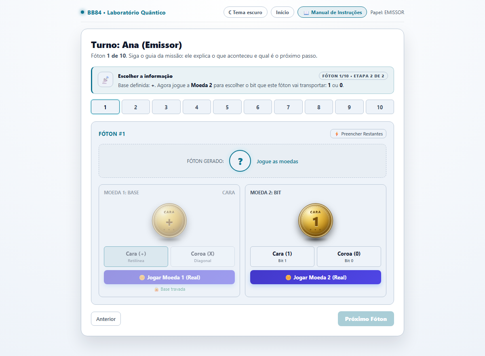
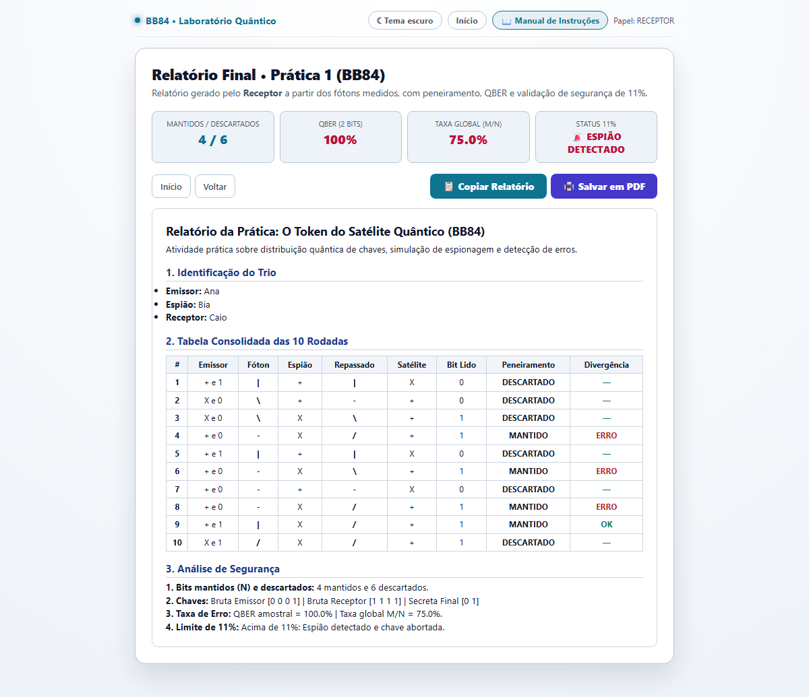
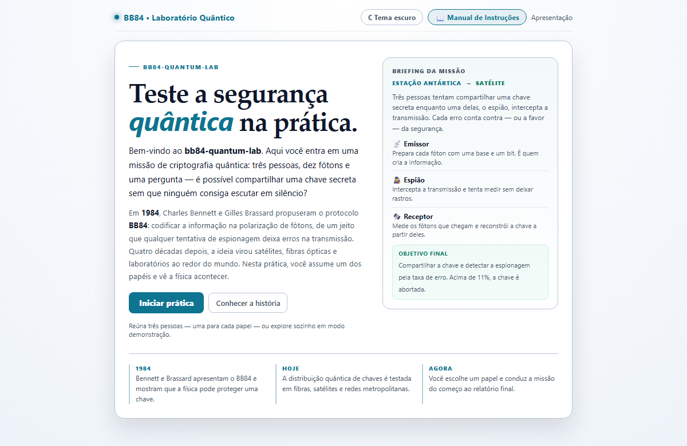
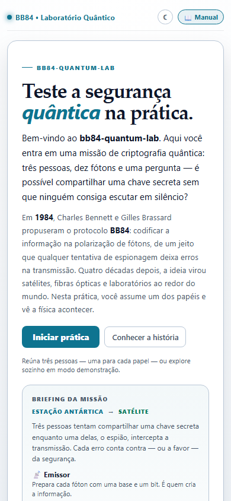
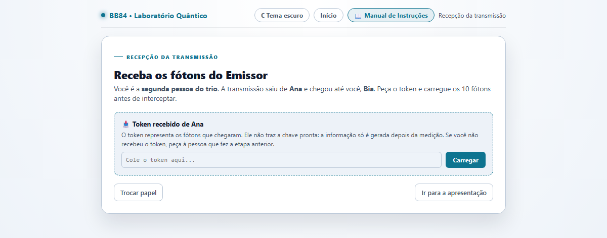

<div align="center">

# BB84 Quantum Lab

**Uma parceria com a Uinversidade Virtual do Paraná (UVPR).**

Um simulador educacional do protocolo BB84: três pessoas, dez fótons e um espião no caminho.

[](https://irlansouza93.github.io/bb84-quantum-lab/)
[](https://irlansouza93.github.io/bb84-quantum-lab/)
[](https://github.com/irlansouza93/bb84-quantum-lab/releases)

### [Abrir o simulador no navegador](https://irlansouza93.github.io/bb84-quantum-lab/)

<sub>Sem instalação, cadastro ou servidor.</sub>


</div>

## Sobre

O **BB84 Quantum Lab** transforma a distribuição quântica de chaves em uma missão jogável. O Emissor prepara fótons, o Espião tenta interceptá-los e o Receptor mede o que chega. A segurança não vem de uma senha mais difícil: vem das leis da física. Qualquer tentativa de espionagem deixa erros detectáveis.

A interface tem **temas claro e escuro**, funciona em celular e não exige build. Cada pessoa usa o próprio dispositivo e a transmissão circula por um token de texto — sem servidor e sem cadastro.

## Preview

| Emissor em ação | Relatório final |
|:---:|:---:|
|  |  |

<details>
<summary>Ver a apresentação nos dois temas</summary>
<br>

| Tema claro | Tema escuro |
|:---:|:---:|
|  |  |

</details>

<p align="center">
  
  <br>
  <sub>Layout adaptado para celular.</sub>
</p>

## Como funciona

| Papel | Responsabilidade | Objetivo |
| --- | --- | --- |
| **Emissor** | Escolhe base e bit de cada fóton. | Criar uma chave que o Receptor consiga reconstruir. |
| **Espião** | Mede cada fóton com uma base secreta. | Passar despercebido e adivinhar a chave. |
| **Receptor** | Mede os fótons com a própria base. | Obter a mesma chave, detectar a espionagem e gerar o relatório. |

Cada fóton carrega **1 bit**. A base é o “alfabeto” usado para preparar ou medir; a polarização é a forma como o bit é escrito. Quando o Espião usa a base errada, o estado colapsa e o erro aparece na comparação final.

## O fluxo em três etapas

1. **Emissor:** prepara os 10 fótons e gera o primeiro token.
2. **Espião:** recebe o token, intercepta os fótons e gera o segundo token.
3. **Receptor:** recebe o token, mede o que chegou e gera o relatório final.

| Recepção do token |
|:---:|
|  |

### Três pessoas, três dispositivos

A experiência completa usa **três pessoas diferentes**. Cada integrante entra no próprio dispositivo, digita o próprio nome e escolhe um papel. Ao final de cada etapa, quem terminou copia o token e envia para a próxima pessoa, que o carrega na tela de **Recepção da transmissão**.

O sistema valida o estágio do token: um token do Emissor não é aceito na entrada do Receptor, e vice-versa.

### Modo demonstração

Também é possível explorar sozinho. Use **Continuar sozinho (demonstração)** ao final de cada etapa para simular os três papéis no mesmo dispositivo — útil para testar rápido, mas a lógica do Espião só ganha sentido quando outra pessoa preparou os fótons.

## O que você vai aprender

- O que são **fótons**, **polarização** e as bases retilínea (`+`) e diagonal (`X`).
- Como quatro estados quânticos codificam os bits `0` e `1`.
- Por que medir com a base errada causa **colapso** e gera erros.
- Por que o **teorema da não clonagem** impede uma cópia perfeita.
- O que é **peneiramento** (sifting) e por que só parte dos bits vira chave.
- O que é **QBER** e por que o limite de **11%** indica a presença de um espião.
- A diferença entre **codificação** (Base64) e **criptografia**.

## Relatório e limite de 11%

O relatório consolidado traz:

- **Mantidos (N):** fótons em que Emissor e Receptor usaram a mesma base.
- **Descartados:** fótons com bases diferentes, removidos no peneiramento.
- **QBER amostral:** erro nos 2 primeiros bits mantidos, revelados publicamente.
- **Taxa global (M/N):** erro em todos os bits mantidos.
- **Chaves:** bruta do Emissor, bruta do Receptor e chave secreta final.
- **Veredito:** acima de 11%, espião detectado e chave abortada.

> **Nota estatística:** com apenas 2 bits de amostra, o QBER é uma indicação didática, não uma prova. Um resultado 0% em 2 bits não garante ausência de espião — por isso o relatório também exibe a taxa global.

## Rodando localmente

Não há build nem instalação. Abra `index.html` no navegador.

Se preferir um servidor local:

```bash
python -m http.server 8000
```

Depois acesse `http://localhost:8000`.

## Estrutura

```text
bb84-quantum-lab/
├── index.html          # aplicação completa (HTML, CSS e JS)
├── docs/
│   ├── demo.gif        # demonstração dos temas
│   ├── home-light.png
│   ├── home-dark.png
│   ├── game-light.png
│   ├── receive-light.png
│   ├── report.png
│   └── mobile-light.png
├── .gitignore
└── README.md
```

## Versão

A versão atual é a **[v1.0.0](https://github.com/irlansouza93/bb84-quantum-lab/releases/tag/v1.0.0)**. Consulte a página de [releases](https://github.com/irlansouza93/bb84-quantum-lab/releases) para o histórico de mudanças.

## Limitações didáticas

Este é um modelo simplificado, não uma implementação criptográfica:

- não há ruído no canal: sem espião, o erro é 0%;
- o Espião intercepta todos os fótons e sempre repassa um estado;
- a amostra pública tem apenas 2 bits;
- não há correção de erro, amplificação de privacidade nem autenticação do canal clássico;
- o token é Base64, ou seja, codificação reversível, não criptografia;
- são 10 fótons para caber em uma aula.

---

<div align="center">

**BB84 Quantum Lab** é um simulador didático de código aberto para aulas de física, computação e segurança da informação.

<sub>Referência original: Bennett, C. H.; Brassard, G. <em>Quantum cryptography: Public key distribution and coin tossing</em> (1984).</sub>

</div>
